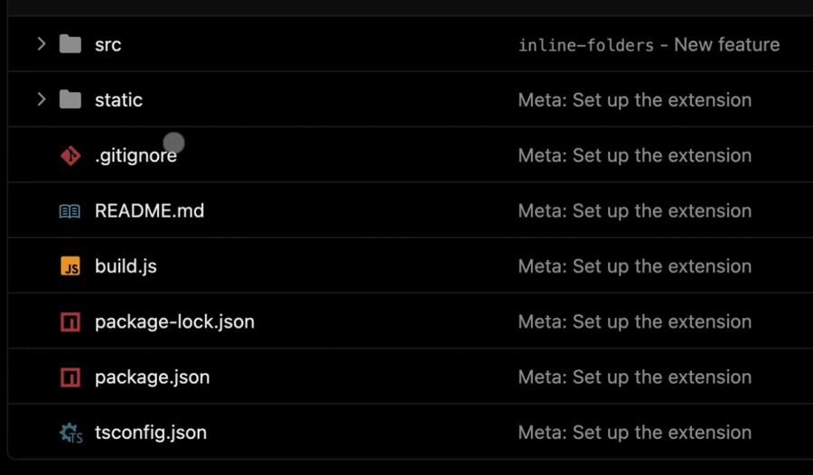

# &nbsp;&nbsp;Buffed GitHub

Buffs for GitHub: small improvements to its interface.

## Features

| Feature | What it does |
|---|---|
| Inline folders | Click a folder in a repo's file table to expand it in place, with a chevron, last commit and date for each item.   |
| Black theme | Pure black backgrounds and flatter borders in GitHub's dark mode. Light mode is left alone. |

Each feature can be switched off in the extension's settings.
